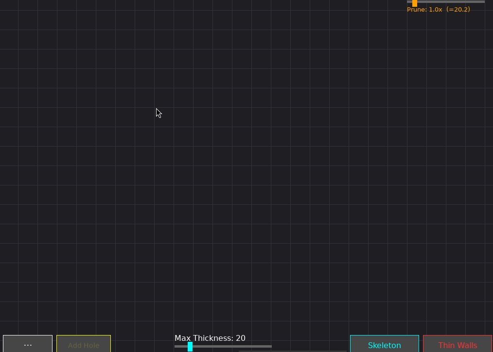

# Thin Wall Visualizer

An application made to identify and visualize thin walls in 2D slices of 3D models. This project was motivated by additive manufacturing, where infill strategies for a given filament width cannot traverse some regions of a part's slice because they are too narrow.

The algorithm is described in `docs/main.pdf`.



## Structure

```
docs/   Document regarding the algorithm design (its pseudocode) and also some examples
src/    Source code for the main app, CMakeLists.txt and a Python script to generate slices from .3mf files
        assets/polygons/   test polygons (.txt)
```

## Requirements

- CMake >= 3.14
- C++17 compiler
- [CGAL](https://www.cgal.org/)
- [SFML 3](https://www.sfml-dev.org/) 

## Build

```bash
cd src
mkdir build
cd build
cmake ..
make
```

## Run

```bash
./build/thin_wall_vis [name]
```

With "name", the polygon is loaded from a file path or from `src/assets/polygons/<name>.txt`. Without it, you draw the polygon by hand. The assets path is fixed at compile time, so rebuild if you move the source directory.

## Controls

Click to place the outer polygon vertices and click near the first vertex to close it. Closing the polygon builds the skeleton and runs the analysis. The *Max Thickness* slider (bottom) and the *Prune* slider (top right) update the result live.

| Input | Action |
|---|---|
| `H` / *Add Hole* | draw a hole (click near the first vertex to close it) |
| `Esc` | cancel the hole being drawn |
| `R` / *Reset* | clear everything |
| `L` | reload the loaded file |
| *Skeleton* button | toggle skeleton view |
| *Thin Walls* button | toggle thin wall polygons view |
| `U` | unify thin wall polygons (Thin Walls view) |
| `=` | show the medial axis without branch pruning |

## Generating polygons

`script.py` slices a `.3mf` model at a given height and exports the contours as a `.txt` polygon.

```bash
pip install numpy trimesh shapely matplotlib
python script.py <name> [--z HEIGHT] [--tol TOL] [--no-preview]
```

Reads `assets/polygons/<name>.3mf` and writes `assets/polygons/<name>.txt`.

| Option | Description | Default |
|---|---|---|
| `--z` | slice height Z in mm | 10.0 |
| `--tol` | RDP simplification tolerance in mm | 0.5 |
| `--no-preview` | skip the preview window | |

## Polygon file format

```
OUTER
x,y
...
HOLE
x,y
...
```

One OUTER block, followed by zero or more HOLE blocks.
